# Aaditya Raj

### Computer Science Student | Software Engineering | Problem Solving | Artificial Intelligence

I am Aaditya Raj, a Computer Science and Engineering student with a growing interest in algorithmic problem solving, software engineering, and the development of intelligent systems. My journey in computer science is driven by a simple idea: understanding the fundamentals deeply is what makes it possible to build meaningful things with technology.

I see programming as more than the process of translating ideas into code. It is a discipline that demands logical reasoning, patience, precision, and the willingness to approach a problem from different perspectives. Whether I am working through a challenging algorithmic problem or developing a software project, I try to understand the underlying principles rather than settle for a solution that merely works.

This profile represents my ongoing effort to strengthen those fundamentals, improve my problem-solving ability, and become a more capable and thoughtful engineer.

## My Approach to Problem Solving

Data Structures and Algorithms form an important part of my learning journey. Through regular practice, I am working toward developing a stronger understanding of how problems can be broken down, analyzed, and solved efficiently.

I am particularly interested in recognizing patterns across different problems, understanding the reasoning behind algorithmic techniques, and evaluating the trade-offs between alternative solutions. I believe that the ability to choose an appropriate approach is just as important as the ability to implement it correctly.

My practice includes fundamental data structures, recursion, searching and sorting, trees, graphs, greedy algorithms, backtracking, and dynamic programming. As I progress, I revisit concepts, analyze mistakes, and explore opportunities to improve both the clarity and efficiency of my solutions.

I primarily use C++ for algorithmic practice while continuing to strengthen my programming fundamentals and broaden my understanding of problem-solving techniques. I also use Python for projects and practical experimentation.

For me, progress is not defined solely by the number of problems solved. It is reflected in the quality of my reasoning, the depth of my understanding, and my ability to apply what I have learned to problems I have never encountered before.

## Beyond Algorithms

While algorithmic problem solving helps develop a strong technical foundation, I am equally interested in understanding how software systems are designed, implemented, tested, and maintained in practice.

My project work has introduced me to backend development, REST APIs, databases, optical character recognition, and applications built around large language models. These experiences have helped me appreciate the relationship between theoretical concepts and the engineering decisions involved in building reliable software.

I am particularly interested in artificial intelligence and autonomous agents, including the ways in which software can retrieve information, reason over evidence, execute structured workflows, and produce useful results. I enjoy exploring these ideas through practical projects while paying attention to reliability, maintainability, and the limitations of the systems I build.

I also value open-source software as an opportunity to learn from established codebases, understand different engineering approaches, collaborate with other developers, and contribute to work that extends beyond individual projects.

## Engineering Principles

I believe good engineering begins with a clear understanding of the problem. A technically sophisticated solution is not necessarily the right solution if it introduces unnecessary complexity or fails to address the actual requirement.

I try to approach development with an emphasis on clarity, correctness, and continuous improvement. I value readable code, deliberate design decisions, meaningful testing, and an understanding of the trade-offs involved in choosing one approach over another.

When a solution fails, I see it as an opportunity to investigate assumptions, identify the underlying cause, and improve my understanding. When a solution succeeds, I try to understand why it works and whether there is a more appropriate or efficient approach.

These principles influence how I approach both LeetCode problems and larger software projects.

## What I Am Working Toward

My goal is to develop into a well-rounded software engineer with strong algorithmic fundamentals, sound problem-solving skills, and the ability to translate ideas into dependable software.

I am continuing to strengthen my understanding of Data Structures and Algorithms, improve my proficiency in C++ and Python, and explore the engineering practices that support the development of production-quality applications.

At the same time, I want to deepen my understanding of artificial intelligence, contribute to open-source projects, and gain experience working on technically challenging problems with other developers.

I understand that meaningful progress in computer science takes time. It requires consistency, curiosity, and a willingness to work through difficult concepts rather than avoid them. I approach this journey as a continuous learning process, where each problem, project, and technical challenge provides an opportunity to improve.

## A Continuous Learning Journey

This LeetCode profile serves as a record of that process. Every solution represents an attempt to understand a problem, reason about its constraints, and implement an appropriate approach. Over time, I hope this collection reflects not only greater problem-solving experience, but also better judgment, stronger fundamentals, and a more disciplined approach to engineering.

I am always interested in learning from different perspectives, exploring unfamiliar technologies, and exchanging ideas with people who care about building useful and reliable software.

My focus remains on developing a strong foundation, applying it through practical work, and improving steadily through experience.

**LeetCode:** https://leetcode.com/u/Aaditya_Raj1101/

**GitHub:** https://github.com/AadityaRaj59
### LeetCode Stats & Activity

[View my LeetCode Profile](https://leetcode.com/u/Aaditya_Raj1101/)
<!-- Generated heatmaps; refreshed by GitHub Actions -->
## Coding Activity

  

  <a href="https://github.com/AadityaRaj59">GitHub</a> ·
  <a href="https://leetcode.com/u/Aaditya_Raj1101/">LeetCode</a>

