<!-- Generated heatmaps; refreshed by GitHub Actions -->
## Coding Activity

  

  

  <a href="https://github.com/AadityaRaj59">GitHub</a> ·
  <a href="https://leetcode.com/u/Aaditya_Raj1101/">LeetCode</a>

